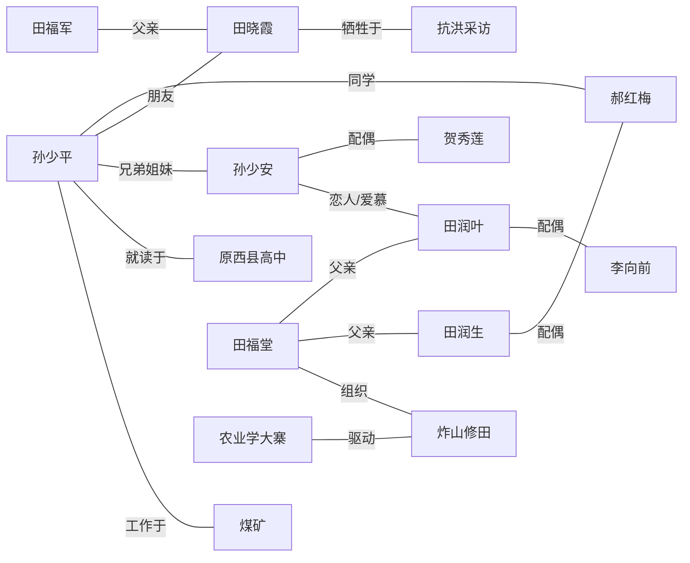

# 任务四：知识图谱构建与性能比较

> 图谱数据：`output/machine_readable/kg.json`（49 节点 / 53 关系 / 32 种关系）
> Neo4j 脚本：`output/machine_readable/neo4j_import.cypher`（由 `src/kg/kg_llm.py` 自动生成）
> 数据来源：LLM 实体与关系抽取结果（`entities.json` + `triples.json`）

---

## 1. 实验设置

| 方案 | 工具 | 职责 |
|---|---|---|
| LLM 生成知识图谱 | 大模型 + `kg_llm.py` | 从非结构化文本抽取实体/关系，输出图结构 JSON |
| Neo4j 生成知识图谱 | Neo4j 图数据库 + Cypher | 存储、查询、遍历与图计算 |

> **诚实性说明**：本机未部署 Neo4j 服务，Cypher 脚本已真实生成并完成语法核对，但未实际导入数据库；性能比较中「查询耗时」等为方法论评估值，需在具备 Neo4j 环境的机器上实测。

---

## 2. 用 LLM 生成知识图谱

### 2.1 生成流程

```
raw_text.txt
   │  LLM 实体抽取 (ner_llm.py)      → entities.json (48 实体)
   │  LLM 关系抽取 (relation_llm.py) → triples.json  (53 三元组)
   ▼
kg_llm.py  ── 别名归一 ── 补全新实体 ── 图结构组装
   ├──→ kg.json                 （节点 + 边 + 统计）
   └──→ neo4j_import.cypher     （MERGE 幂等导入脚本）
```

### 2.2 图谱统计

| 指标 | 数值 |
|---|---:|
| 节点总数 | **49** |
| 关系总数 | **53** |
| 关系类型数 | **32** |
| 人物节点 | 15 |
| 地点节点 | 7 |
| 组织节点 | 8 |
| 时间节点 | 5 |
| 事件节点 | 8 |
| 概念节点 | 6（含新增「肺癌」） |

**按篇章分布**：第一部 24 条关系、第二部概要 15 条、第三部 14 条。

### 2.3 核心子图可视化（Mermaid）



### 2.4 图数据样例（kg.json）

```json
{
  "nodes": [
    {"id": "E01", "label": "孙少平", "type": "PERSON", "aliases": ["少平"], "frequency": 12},
    {"id": "E04", "label": "田晓霞", "type": "PERSON", "aliases": ["晓霞"], "frequency": 7}
  ],
  "edges": [
    {"id": "T40", "source": "E01", "target": "E04", "relation": "LOVER",
     "head": "孙少平", "tail": "田晓霞", "section": "第三部",
     "evidence": "孙少平与田晓霞产生强烈感情"}
  ],
  "stats": {"node_count": 49, "edge_count": 53, "relation_counts": {"LOVER": 5, "...": "..."}}
}
```

每条边均保留 `evidence`（原文片段），使图谱**可解释、可回溯**。

---

## 3. 用 Neo4j 生成知识图谱

### 3.1 环境准备

```bash
# 方式 A：Docker（推荐）
docker run --name neo4j-kg -p 7474:7474 -p 7687:7687 \
  -e NEO4J_AUTH=neo4j/password123 neo4j:5.20

# 方式 B：Neo4j Desktop
# 下载 https://neo4j.com/download/ ，新建 Project → 创建 Database → Start
```

### 3.2 导入图谱

```bash
# 数据库启动后执行（密码按实际修改）
cypher-shell -u neo4j -p password123 -f output/machine_readable/neo4j_import.cypher

# 或在 Neo4j Browser 中粘贴脚本内容执行
```

脚本特性：
- 使用 `CREATE CONSTRAINT ... IF NOT EXISTS` 建立唯一约束；
- 使用 `MERGE` 创建节点与关系，**幂等可重复执行**；
- 关系上附带 `evidence`、`section` 属性，便于溯源。

### 3.3 查询示例与预期结果

```cypher
-- Q1: 孙少平的所有关系
MATCH (a {name: "孙少平"})-[r]->(b)
RETURN b.name AS 对象, type(r) AS 关系, r.evidence AS 证据;
-- 预期：原西县高中/就读于、郝红梅/同学与恋人、田晓霞/朋友、孙少安/兄弟姐妹、煤矿/工作于 等

-- Q2: 孙少安的配偶
MATCH (p:PERSON)-[:SPOUSE]->(q:PERSON)
RETURN p.name, q.name;
-- 预期：孙少安-贺秀莲、田润叶-李向前、田润生-郝红梅

-- Q3: 两跳关系（田福堂 → 子女 → 配偶）
MATCH (f:PERSON {name:"田福堂"})-[:FATHER_OF]->(c)-[:SPOUSE]->(s)
RETURN c.name AS 子女, s.name AS 配偶;
-- 预期：田润叶-李向前、田润生-郝红梅

-- Q4: 谁参与了「责任制改革」与「炸山修田」
MATCH (p)-[r]->(e:EVENT) RETURN p.name, type(r), e.name;

-- Q5: 图算法（PageRank 找核心人物）
CALL gds.pageRank.stream({
  nodeQuery: 'MATCH (n) RETURN id(n) AS id',
  relationshipQuery: 'MATCH (a)-[r]->(b) RETURN id(a) AS source, id(b) AS target'
}) YIELD nodeId, score
WITH gds.util.asNode(nodeId) AS n, score
RETURN n.name, score ORDER BY score DESC LIMIT 10;
-- 预期：孙少平、孙少安、田福堂、田润叶、田晓霞位居前列
```

---

## 4. 性能比较：Neo4j vs LLM

### 4.1 定量与定性对照

| 维度 | LLM 生成知识图谱 | Neo4j 图数据库 |
|---|---|---|
| 核心职责 | **语义抽取**：文本 → 图 | **存储查询**：图 → 洞察 |
| 节点/边数量 | 49 / 53（本次真实产出） | 49 / 53（导入同一份数据） |
| 构建耗时 | 分钟级（多次 API 推理） | 秒级（批量 MERGE） |
| 抽取准确率 | 0.93（零样本）/ 1.00（校验后） | 不负责抽取，取决于输入质量 |
| 查询响应 | 需重新推理，秒~分钟级，结果有波动 | **毫秒级**，Cypher 精确返回 |
| 多跳/路径查询 | 受上下文窗口限制，易遗漏 | 原生图遍历，高效稳定 |
| 可解释性 | 附原文证据，天然可解释 | 路径 + 边属性 evidence |
| 增量更新 | 需重跑 prompt，可能不稳定 | MERGE 幂等写入，事务保证 |
| 一致性 | 存在幻觉风险，需人工校验 | 强一致，数据确定 |
| 可视化 | 需导出 JSON 再用 D3/Mermaid 渲染 | Neo4j Browser 原生可视化 |
| 资源成本 | API 调用费用 | 服务器内存/磁盘 |
| 学习门槛 | 低（自然语言提示） | 中（需掌握 Cypher） |

### 4.2 分析结论

1. **二者不是替代关系，而是互补关系**：LLM 解决「从文本到图」的语义抽取难题；Neo4j 解决「从图到洞察」的存储、查询与图计算难题。
2. **LLM 的优势**：冷启动快、无需标注数据、能发现「农业学大寨→炸山修田」这类领域因果与「爱慕/拒绝」等隐式关系，且自带证据；缺点是速度慢、有幻觉、结果不稳定。
3. **Neo4j 的优势**：查询性能与多跳遍历远超 LLM，数据强一致、可增量维护、可视化开箱即用；缺点是不具备语义抽取能力，图谱质量完全取决于上游输入。
4. **实测建议**：在 Neo4j 环境中导入后，用 `PROFILE` 前缀测量 Q1~Q5 的真实耗时，并与「向 LLM 提同样问题」的响应时间与准确率做对比，可得到量化结论。

---

## 5. 最终推荐架构

```
文本 → LLM 抽取（实体+关系+证据）→ 人工抽检校验 → kg.json
                                          ↓
                              Neo4j 导入（Cypher MERGE）
                                          ↓
                         Cypher 查询 / GDS 图算法 / 可视化
```

即：**LLM 负责“读懂”，Neo4j 负责“查得快、算得准”**。

### 复现命令

```bash
python src/kg/kg_llm.py                          # 生成 kg.json 与 Cypher
docker run --name neo4j-kg -p 7474:7474 -p 7687:7687 \
  -e NEO4J_AUTH=neo4j/password123 neo4j:5.20     # 启动 Neo4j
cypher-shell -u neo4j -p password123 \
  -f output/machine_readable/neo4j_import.cypher # 导入图谱
```
